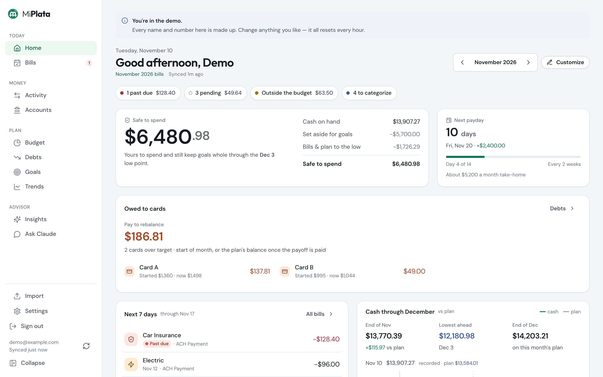
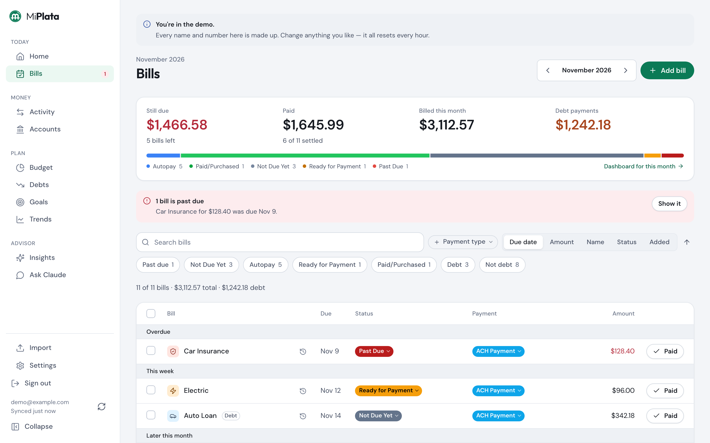
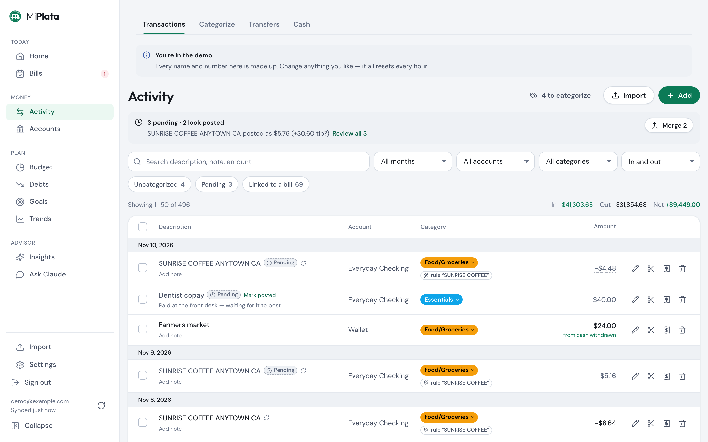
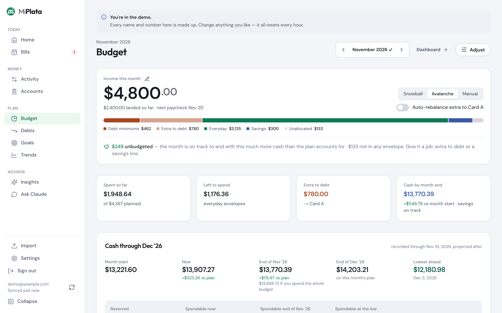
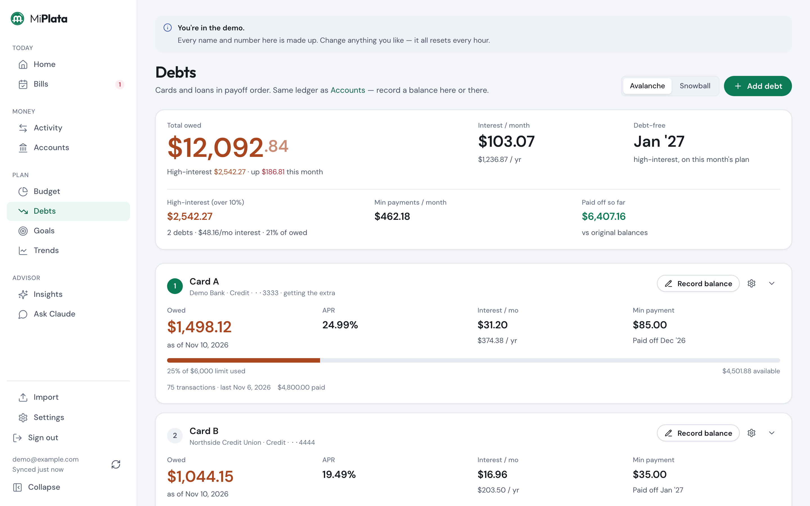
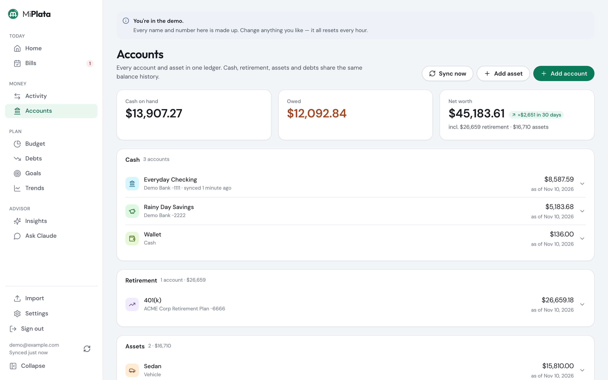
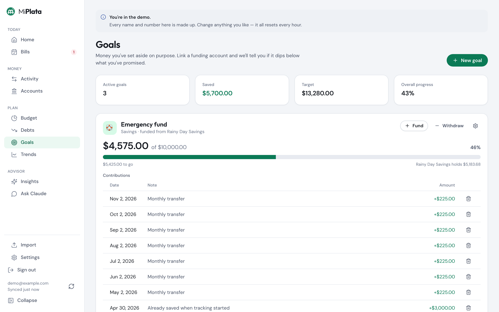

# Personal Finance Tracker

**The app I built to run my own money, and still use to do it.**

Built by **Tyler Clay** — [tylerthedeveloper.com](https://tylerthedeveloper.com)·
[Candy Creative](https://candycreative.digital)·
[Donate](https://paypal.me/tylerclay2019)



Bills, bank transactions, debts, budgets and savings goals in one place — on your own
server, with your data in your own database. Optionally, Claude as a financial advisor that
can read your real numbers.

**[Try the live demo](https://finance.candycreative.digital)** · **[Get started](docs/getting-started.md)** · **[Feature tour](docs/features.md)**

## Run it with Docker

```bash
git clone https://github.com/slicktdog08/personal-finance-tracker && cd personal-finance-tracker
docker compose -f compose.selfhost.yml up -d
```

Open <http://localhost:3000> and create your account. That's it: the database, the schema
and sign-in are all included. No cloud account needed.

Prefer Node and your own MySQL, or a guided setup with Claude Code?
See **[Getting started](docs/getting-started.md)**.

## What you get

<table>
<tr>
<td width="50%" valign="top">

**A bill sheet for every month**

Recurring bills carry forward, with statuses that match how bills actually work, linked to
the payments that cleared them.



</td>
<td width="50%" valign="top">

**Every transaction, categorized**

Import CSVs or PDFs, connect a bank, or type one in. Rules categorize on the way in, and
duplicates are rejected.



</td>
</tr>
<tr>
<td valign="top">

**A budget that fills itself in**

Plan the month as envelopes; the "actual" side comes straight from your transactions.



</td>
<td valign="top">

**A way out of debt**

APR, utilization and interest cost per debt, with avalanche or snowball projections and a
debt-free date.



</td>
</tr>
<tr>
<td valign="top">

**The whole picture**

One ledger for everything you own and owe, with balance history, net worth and trends.



</td>
<td valign="top">

**Goals that check reality**

Savings goals are measured against the real account balance, so a goal shows a shortfall
if the money was spent. Every screen also works on a phone.



</td>
</tr>
</table>

Also: a day-by-day cash projection, a payday countdown, split and pending transactions,
transfer pairing, cash tracking, recurring-bill suggestions, and AI insights.
**[The full tour →](docs/features.md)**

## Getting your transactions in

| Way | Good for |
|---|---|
| **CSV file** | Any bank. Map the columns once; overlapping exports never double-count |
| **PDF statement** | Accounts with no CSV export |
| **Bank sync** | Hands-off updates through SimpleFIN or Plaid, including pending charges |
| **By hand** | Cash, or a charge that hasn't posted yet |
| **Through Claude** | "Add the $40 I spent at lunch" |

**[How each one works →](docs/importing.md)**

## Documentation

| | |
|---|---|
| [Getting started](docs/getting-started.md) | Docker, Claude-guided, or by hand — and what to do first |
| [Docker](docs/docker.md) | The image, settings, upgrades, backups |
| [Importing](docs/importing.md) | All five ways to get transactions in |
| [Authentication](docs/authentication.md) | Built-in accounts (default) or AWS Cognito |
| [Connecting Claude](docs/claude-mcp.md) | The MCP advisor, in-app insights, the advisor profile |
| [Hosting](docs/hosting.md) | A server, a domain, HTTPS, CI/CD |
| [Configuration](docs/configuration.md) | Every environment variable |
| [Demo](docs/demo.md) | What demo mode is and how to run one ([live demo](https://finance.candycreative.digital)) |
| [Feature tour](docs/features.md) | Everything it does, and its honest limitations |
| [Development](docs/development.md) | Commands, tests, code layout, keeping personal data out of git |
| [Why this exists](docs/why.md) | The story, and what got built when |

## What you need

| | |
|---|---|
| **Docker** | The only requirement for the quick start |
| *or* **Node.js 22+ and MySQL 5.7+** | To run it without Docker (MySQL 8 and MariaDB work too) |
| **A server with HTTPS** | Only if you want it reachable away from home — [hosting](docs/hosting.md) |
| **Claude** | Optional, for the advisor and the guided `/setup` |
| **AWS Cognito** | Optional alternative to the built-in sign-in |

It is single-user, single-currency (USD), and opinionated: it assumes a monthly bill sheet
plus transactions. [More honest downsides](docs/features.md#limitations-and-honest-downsides).

## Disclaimer
I am a 9+ year software engineer with experience building apps that store peoples ssn, dob, and other valuable information. 
Effort has been put into ensuring that this app isn't leaking personal information, but its engineered with
agentic tooling. For this reason I recommend ***NEVER*** storing your full account and/or credit/debit card numbers in
either this repo or your database. I cannot accept liability if things go left. You can tell by the apps heavy emphasis 
on debt snowballing that suing me won't net you any money so use at your own risk.

## Support Me
If you want to fork and customize go ahead! If you want a senior software engineer who can architect things like this in a weekend 
or two lets have a conversation. My development experience goes way back before AI but I'm not the type to stick with the shovel 
when the new crew comes in with these shiny excavator things. This would have taken me a few months in the pre-ai era. Enjoy the fruits
of my (and claudes) labor for free. Consider a small donation if this app helped you.
