# What it does

A tour of every feature. Screenshots are from the [demo](demo.md), so the numbers are made up.

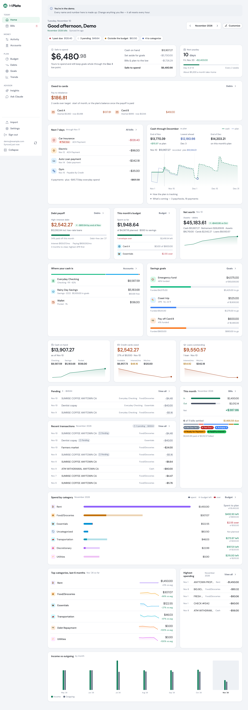

### Bills: the monthly sheet, without the busywork

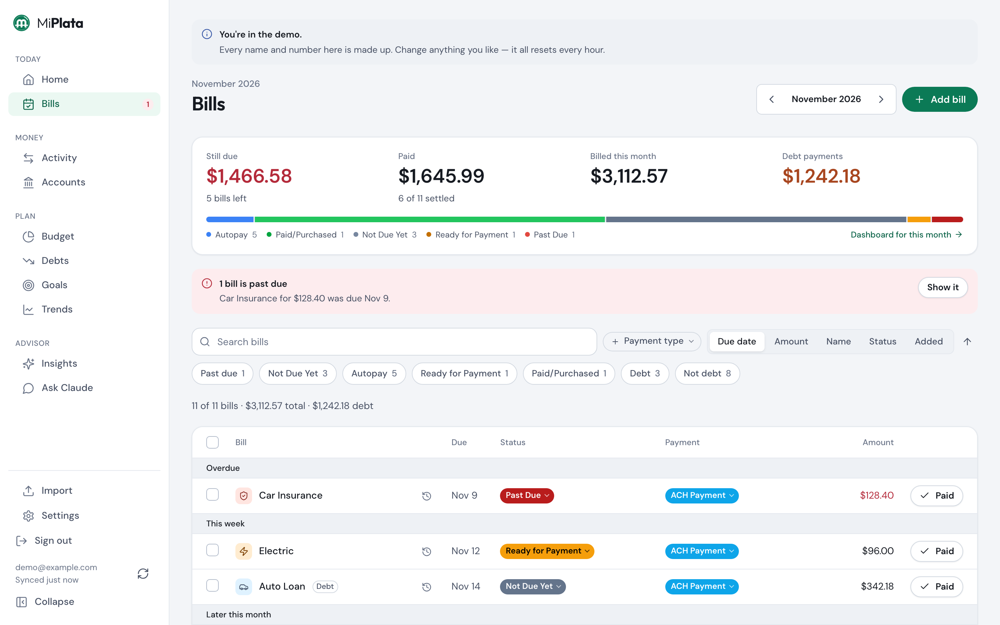

- **One sheet per month.** Each month opens with your recurring bills carried forward from the
  last, ready to edit inline: status, amount, due day and payment type.
- **Statuses that match how bills really work.** Sixteen of them out of the box (Unpaid,
  Autopay, Autopay Pending, Partial Payment, Past Due, Skipped, Paid & Cancelled and more),
  all customizable with your own colors and emoji. Bulk-update a whole month at once.
- **Bills linked to the payments that cleared them**, so you can see exactly which transaction
  paid which bill.
- **Recurring-bill suggestions.** It spots repeating charges in your transactions and offers to
  turn them into bills. You can also merge or rename bills whose names drifted over time.

### Transactions: getting real bank data in, cleanly

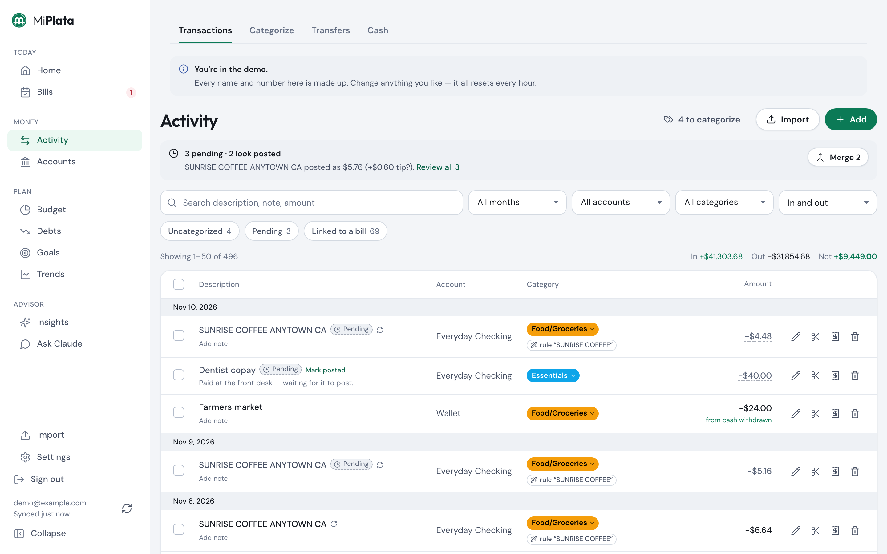

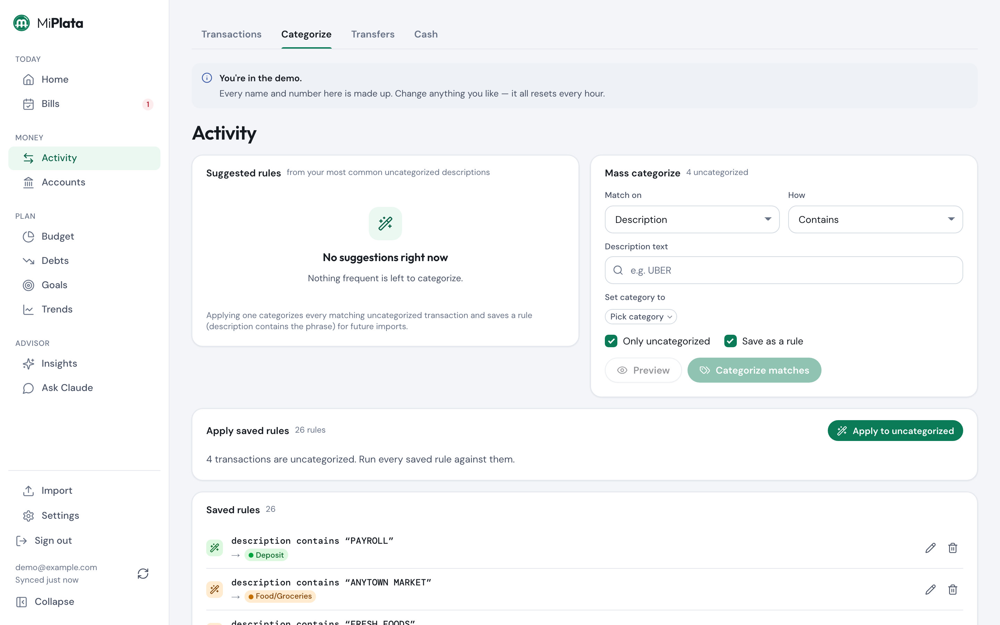

There are five ways to get transactions in — CSV, PDF, bank sync, by hand, and through
Claude. [importing.md](importing.md) compares them.

- **Bank sync.** Link accounts through SimpleFIN Bridge or Plaid and transactions, pending
  charges and balances arrive on their own, on a schedule or on demand.
- **CSV import from any bank.** Map the columns once and the app remembers that layout and
  guesses the rest: dates, debit/credit vs. signed amounts, and which account it belongs to.
  Duplicates are rejected using the transaction's actual facts (account, date, amount,
  description), not the bank's IDs, which change between exports. Re-importing an overlapping
  date range is harmless.
- **Running balances.** If the CSV has a balance column, it's recorded as a dated balance snapshot.
- **PDF statement import** for accounts that only give you PDFs. It records the opening and
  closing balances and de-duplicates across statements. Parsers are per-issuer; one ships
  today (Robinhood Spending).
- **A review step before anything is saved.** Every import shows a preview where you can
  categorize, write notes and settle pending charges. It works on a phone too.
- **Categorization in three layers:**
  1. Saved rules run automatically on import.
  2. A mass-categorize screen clears the backlog.
  3. A one-click inline rule also catches the N similar transactions it finds.
- **Pending transactions.** Bank exports don't include pending charges, so enter them by hand
  (bank sync brings them in itself).
  When the posted version arrives in a later import, it settles into the pending entry even
  if the name, date or amount (say, a tip) changed. Your category, notes and links carry over.
- **Split transactions.** A $100 store run can be $60 groceries and $40 household. The parts
  always add up to the full amount, and cash back is treated as cash.
- **Transfers between your own accounts** are paired and excluded, so moving money from
  checking to a credit card doesn't count as spending one way and income the other.
- **Cash offsets.** An ATM withdrawal is spending until you say what it bought. Log cash
  purchases and they move money out of "unaccounted cash" into real categories. Count what's
  left in your wallet and that portion counts as cash on hand, not spent.

### Accounts, debts and the big picture

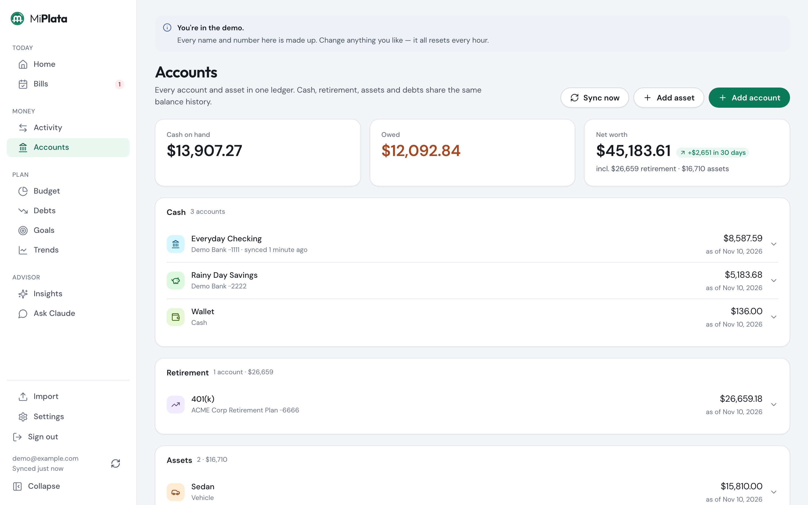

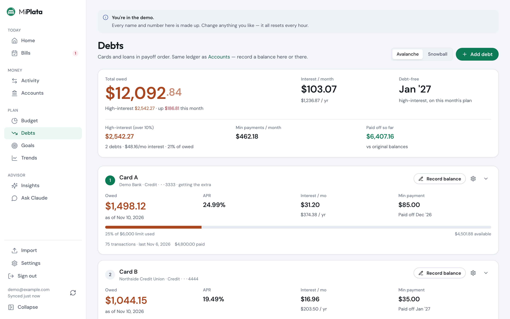

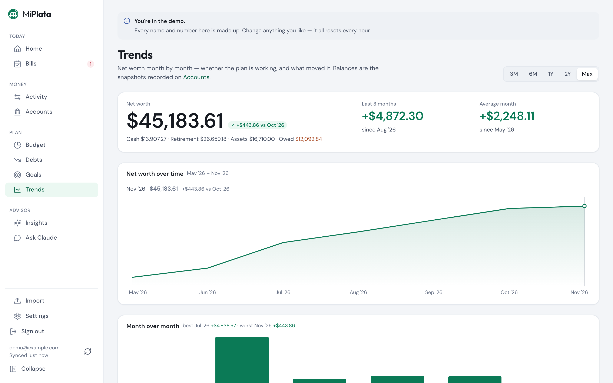

- **One ledger for everything you own and owe.** Checking, savings, cash, credit cards and
  loans each have dated balance history. Past months show what balances actually were then,
  not what they are today.
- **Debts.** Each debt shows APR, minimum payment, credit limit, utilization and what it costs
  you in interest this month, plus avalanche or snowball payoff projections with a debt-free
  date and total interest.
- **Net worth.** Retirement accounts and assets (a car, a home) count toward net worth
  without muddying your spendable cash.
- **Dashboard.** Rearrangeable widgets, with separate layouts for desktop and phone. For any month: cash on hand, total owed, bill status, income vs. spending,
  spending by category, goal progress and trends. Switching months re-renders the whole page
  from that month's data.

### Planning: looking forward instead of back

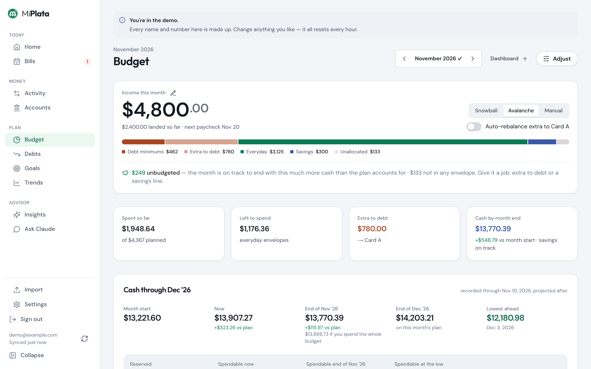

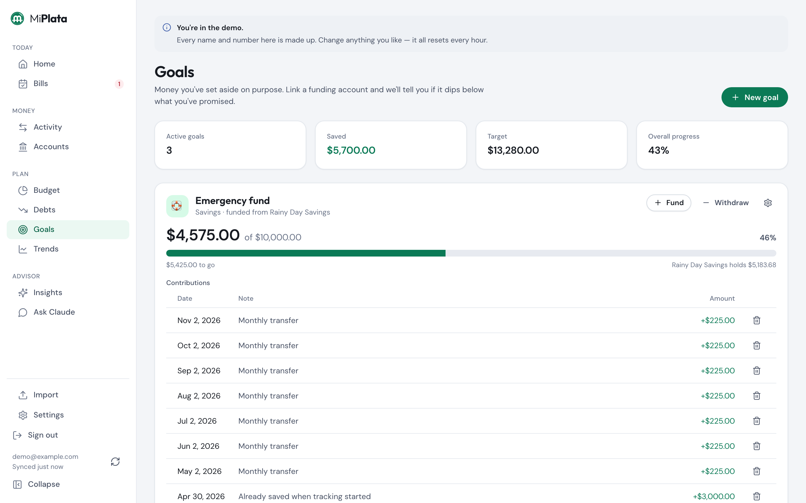

- **Budgets measured against what actually happened.** Plan a month as envelopes, and each
  envelope's "actual" comes straight from that month's transactions. You never type in spending.
  Lines can be locked, the rest rebalance automatically, and a savings line keeps saving visible.
- **Debt-payoff budget generator.** It drafts the month from your live data: income from your
  pay schedule, bills, minimum payments and recent spending. Whatever's left goes to the debt
  you're targeting, and it warns you when the plan doesn't fit.
- **Cash projection.** A day-by-day forecast of your cash through the end of the month and the
  next: upcoming bills, paydays and remaining budget. It shows the low point before it happens.
  Paydays are checked against the deposits that have actually landed, so a paycheck split
  across two deposits isn't counted twice.
- **Savings goals.** Goals are built from a running list of contributions. For goals tied to
  a real account, progress is checked against that account's balance, so a goal shows a
  shortfall if the money has actually been spent.
- **Pay schedule and payday countdown**: weekly, biweekly, semimonthly or monthly. It's
  deliberately just a countdown ("4 days to go") with no nagging math.

### On a phone

Every screen has a phone layout, and the app installs to the Home Screen.

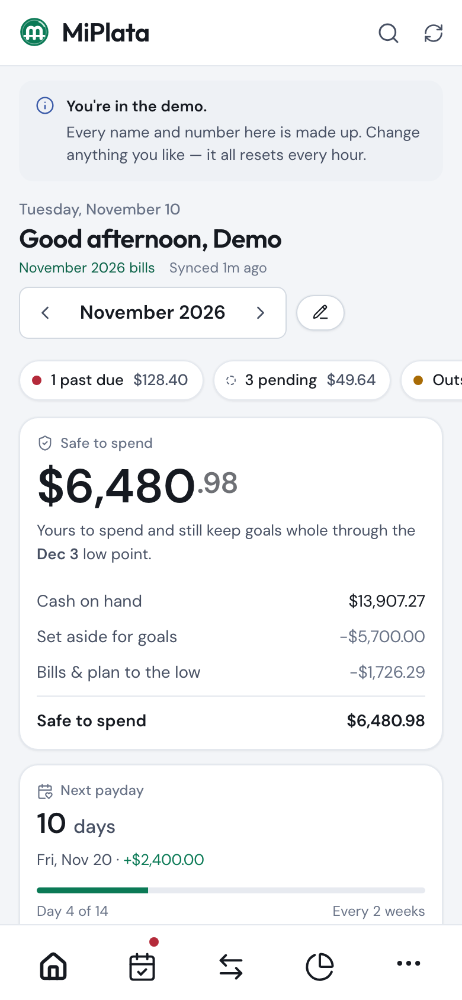
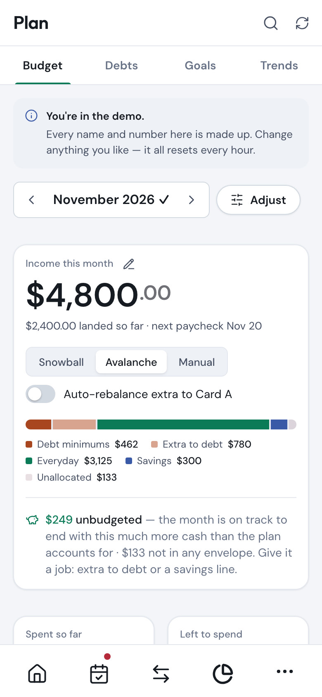

### Claude as a financial advisor (MCP)
The app runs its own [MCP](https://modelcontextprotocol.io) server. You can connect it to
claude.ai or Claude Code and have a real conversation about your actual numbers: "Can I afford
this?", "How did this month go?", "What's my fastest path out of debt?"

- **15 read tools:** snapshot, month summaries, spending and balance trends, debts and payoff
  projections, cash projection, budget, goals and transaction search.
- **9 write tools that only add or edit, never delete:** categorize, split, update bill
  status, add a goal contribution, adjust a budget line, set a debt target, add a transaction,
  record a balance, update the advisor profile. Claude has to tell you exactly what will change and wait for your OK.
- **Built-in prompts:** `monthly_review`, `can_i_afford`, `debt_payoff_plan` and
  `budget_check_in`.
- **A private advisor profile**, stored in your database (never in the repo). It gives
  Claude standing context, such as your situation, your plan, and what money is off-limits,
  so every conversation starts from where you are.
- **Your own sign-in.** Claude authenticates against your install — OAuth through your Cognito
  pool, or a bearer token with built-in accounts — so your data never sits with a third party.
  Setup: [claude-mcp.md](claude-mcp.md).

### Insights and chat inside the app (Claude routine, no API key)
`/insights` and `/advisor` put the advisor in the app itself. The buttons fire a
[Claude Code routine](../planning/features/ai-advisor.md) instead of calling the Anthropic API, so
the work runs on your Claude plan, not metered API credit. The routine reads your data and
writes its answer back through the same MCP connector.

- **Insights:** findings the screens don't show (price creep, category drift, payday spikes,
  leaks, interest cost), each with the dollar impact and the transactions behind it. Mark them
  done or dismiss them; a dismissed finding isn't raised again.
- **Check-ins:** the daily update lands on the Insights page, run on a schedule or on demand.
- **Chat:** ask a question in a thread and the reply shows up there.
- **Runs:** every routine run shows in the app with its status, how long it took and a link to
  its Claude Code session.

## Limitations and honest downsides

This is a tool I built for myself, so these are the trade-offs I live with:

- **Hands-off imports cost a little, or take a little setup.** Bank sync works through
  SimpleFIN Bridge (about $15 a year, roughly daily) or Plaid (free trial tier with a limited
  number of banks, and you need developer keys). Without one of those, keeping the app current
  means downloading a CSV or PDF from each bank and importing it, and typing pending charges
  in by hand. Adding another provider is one adapter behind
  `src/server/lib/sync/provider.ts`; see `planning/features/bank-sync.md`.
- **One PDF parser.** Only Robinhood Spending statements are supported out of the box. Other
  banks need a CSV export or a new parser in `src/server/lib/pdf/parsers/`. Scanned (image)
  PDFs aren't supported because there's no OCR.
- **Single user, single currency.** No households, shared access or roles, and everything is
  in USD.
- **Cash takes discipline.** Cash spending is only as accurate as the purchases you log and
  the wallet counts you record.
- **You host it.** `docker compose up` gets you a working copy in a couple of minutes, but
  it's still yours to run, back up and put behind HTTPS if you want it off your own machine.
- **Opinionated by design.** Categories, statuses and workflows reflect how I manage money.
  They're customizable, but the app assumes a monthly bill sheet plus transactions.
- **Web only.** It works on a phone browser, but there's no native app or offline mode.
- **Not audited.** Auth is careful (token verification on every request, `httpOnly` cookies,
  nothing public by default), but there's no Content-Security-Policy yet, built-in accounts
  have no MFA, and nothing here has had a third-party security review. Treat it as a personal tool.
