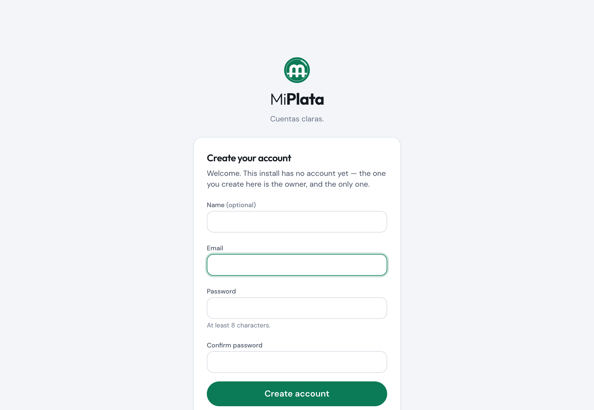

# Getting started

Three ways in, easiest first. All of them end at the same place: the app running, an account
that is yours, and an empty ledger waiting for transactions.

| | You need | Time |
|---|---|---|
| [Docker](#1-docker-the-short-way) | Docker | ~2 minutes |
| [Claude Code](#2-guided-by-claude-code) | Node 22, MySQL, Claude Code | ~10 minutes, guided |
| [By hand](#3-by-hand) | Node 22, MySQL | ~10 minutes |

Just want to look around first? Try the [demo](demo.md), or run your own copy with sample data
(`DEMO_MODE=1`, below).

## 1. Docker (the short way)

```bash
curl -O https://raw.githubusercontent.com/slicktdog08/personal-finance-tracker/main/compose.selfhost.yml
docker compose -f compose.selfhost.yml up -d
```

Open <http://localhost:3000>. The first visit asks you to create your account:



That's the whole install. The compose file starts MySQL and the app; the app creates its own
schema on first boot and applies new migrations on every start. See [docker.md](docker.md)
for passwords, ports, upgrades, backups and putting it behind HTTPS.

To kick the tyres with sample data instead of an empty ledger:

```bash
DEMO_MODE=1 docker compose -f compose.selfhost.yml up -d
```

> `DEMO_MODE=1` **wipes the database and refills it with made-up data on every start**. Use it
> on a throwaway copy, never on the one holding your real finances.

## 2. Guided by Claude Code

```bash
git clone https://github.com/slicktdog08/personal-finance-tracker
cd personal-finance-tracker
npm ci
claude
```

Then type `/setup`. The skill writes `.env.local`, checks your database, creates the schema,
gets you signed in, and offers to interview you for the advisor profile. It never commits
anything personal.

## 3. By hand

1. **Install.** `npm ci`
2. **Create an empty database** and a user that may create tables in it:
   ```sql
   CREATE DATABASE finance;
   CREATE USER 'finance'@'%' IDENTIFIED BY 'choose-a-password';
   GRANT ALL ON finance.* TO 'finance'@'%';
   ```
3. **Configure.** `cp .env.example .env.local` and set `DATABASE_URL`. Nothing else is
   required to start. ([All settings](configuration.md))
4. **Create the schema.** `npm run db:init` loads every table plus the default statuses,
   payment types and categories. It refuses to run on a database that already has tables.
5. **Run.** `npm run dev`, open <http://localhost:3000>, and create your account on the
   first-run screen.

Sign-in is built in: your password is hashed into the database and nothing external is
involved. If you would rather use AWS Cognito, see [authentication.md](authentication.md).

## Then what?

1. **Add your accounts** under **Accounts**: checking, savings, cards, loans.
2. **Get transactions in.** Upload a bank CSV on the **Import** page, or connect a bank. There
   are five ways; [importing.md](importing.md) compares them.
3. **Set your pay schedule** (Settings → Pay schedule) so the dashboard can count down to
   payday and project your cash.
4. **Add your bills** (Settings → Bills), or let the app suggest them from repeating charges
   once you have a couple of months of transactions.
5. **Plan a budget** on the Budget page. Actuals fill in from your transactions.

Optional: [connect Claude](claude-mcp.md) as an advisor that can read your numbers.

## Want sample data in a local install?

```bash
npm run seed:demo            # refuses if the database already has transactions
npm run seed:demo -- --reset # wipes everything first
```

It fills every screen with about six months of fictional history, always relative to today.
Never run it against a database you care about.
