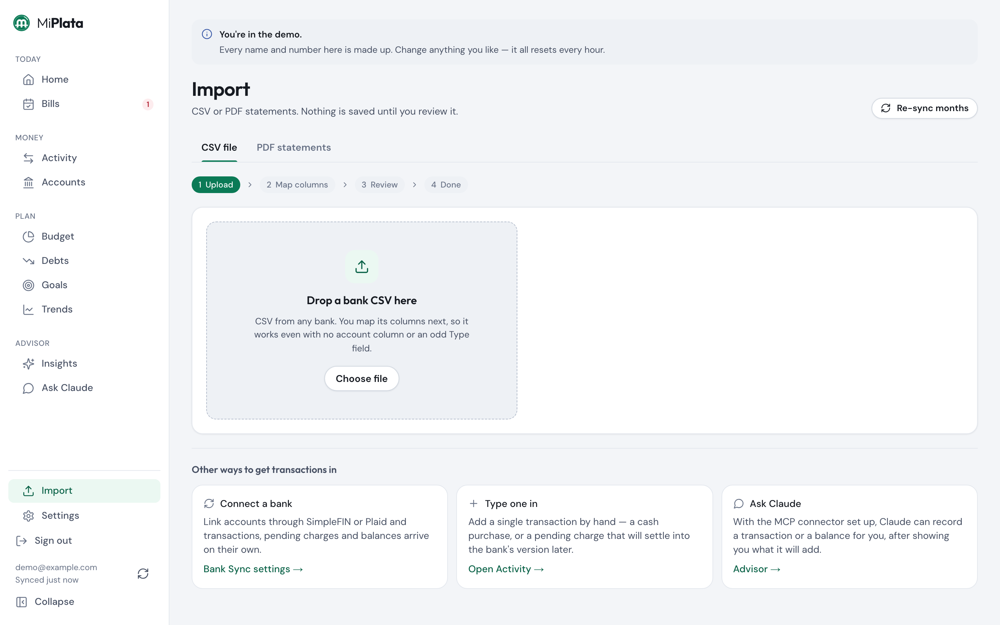
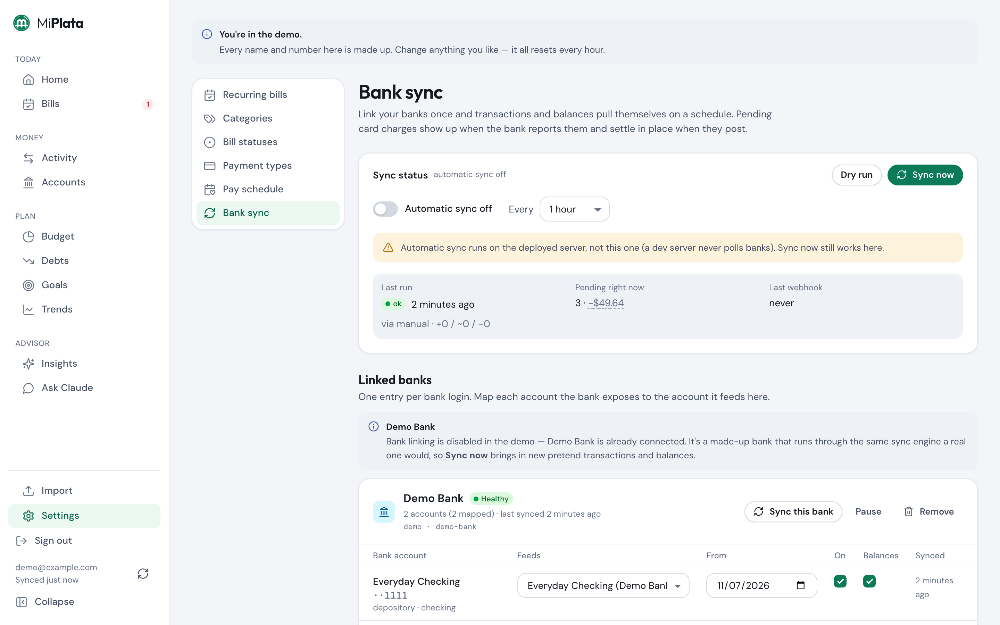

# Getting transactions in

There are five ways to put transactions into the tracker. Use any mix: they all land in the
same ledger, and they all share one duplicate check, so overlapping sources don't double-count.

| | Best for | Effort | Pending charges | Balances |
|---|---|---|---|---|
| [1. CSV file](#1-csv-file) | Any bank, any time | Download + upload | No (banks don't export them) | If the file has a balance column |
| [2. PDF statement](#2-pdf-statement) | Accounts with no CSV export | Upload | No | Opening and closing |
| [3. Bank sync](#3-bank-sync) | Hands-off daily updates | One-time link | Yes | Yes |
| [4. By hand](#4-by-hand) | Cash, or a charge that hasn't posted | Type it | Yes, that's the point | Record separately |
| [5. Through Claude](#5-through-claude) | "Add the $40 I spent at lunch" | Ask | Yes | Yes |

Coming from somewhere else? See [bringing history with you](#bringing-history-with-you).

## 1. CSV file

**Import → CSV file.** Works with any bank's export.

1. **Upload** the file your bank gave you.
2. **Map** its columns. The app guesses from the headers and a sample of rows: which column
   is the date, the description, the amount (one signed column, or separate debit and credit
   columns), and optionally a running balance and category. It remembers the mapping for that
   file layout, so next month the step is already filled in.
3. **Review.** Every row is shown before anything is saved. Saved rules have already
   categorized what they can; fix the rest, add notes, and tick the rows that settle a
   pending charge you typed in earlier.
4. **Commit.** You get a count of new rows, duplicates skipped and errors.

Things worth knowing:

- **Re-importing is harmless.** A row is identified by its account, date, amount and
  description, not by the bank's ID (those change between exports). Download an overlapping
  date range and the rows you already have are skipped.
- **Balances.** If the file has a balance column, the app records it as a dated balance for
  the account, which is what makes past months show what you actually had then.
- **Which account?** Pick it at upload, or let the app infer it from the file.

## 2. PDF statement

**Import → PDF statements.** For accounts that only hand you a PDF. Upload up to 12
statements at once; the app reads the text, pulls out the transactions plus the statement's
opening and closing balances, and takes you to the same review step as a CSV.

- **One issuer is supported today: Robinhood Spending.** Parsers are small and per-issuer;
  adding your bank means one file in `src/server/lib/pdf/parsers/`
  ([how](../planning/features/pdf-import.md)). When a statement isn't recognized, the page
  shows the first lines it extracted, which is the spec for a new parser.
- **Text PDFs only.** A scanned statement is an image, and there is no OCR.

## 3. Bank sync

**Settings → Bank Sync.** Links your accounts through an aggregator so transactions, pending
charges and balances arrive on their own. Two providers are built in; you can use both, with
each account fed by one of them.

| | SimpleFIN Bridge | Plaid |
|---|---|---|
| Cost | About $15 a year, paid to SimpleFIN | Free Trial plan (limited number of banks) |
| Sign-up | An account at bridge.simplefin.org, no approval | A Plaid developer account and API keys |
| Freshness | Roughly daily | Near real time, with webhooks |
| Setup here | Paste a Setup Token | `PLAID_API_CLIENT_ID` + `PLAID_API_SECRET`, then the Link button |

First, once, for either: set `SYNC_TOKEN_ENCRYPTION_KEY` (`openssl rand -hex 32`). Bank
access tokens are encrypted with it before they are stored.

**SimpleFIN:** connect your banks at SimpleFIN Bridge, copy the Setup Token it gives you, and
paste it into *Link with SimpleFIN*.

**Plaid:** set the two keys (and `PLAID_ENV=production` for real banks; the default is the
sandbox), then use *Link with Plaid*. Banks that sign in through their own site (OAuth) also
need `APP_URL` to be your `https://` address and
`$APP_URL/settings/sync/plaid-oauth` registered as a redirect URI in the Plaid dashboard.

After linking, **match each bank account to one of yours and switch it on**. The app proposes
matches but never turns one on by itself.

- **Sync now** runs it on demand. **Automatic sync** runs it on a schedule in a deployed
  build (never under `npm run dev`). A host cron can call `POST /api/sync/run` with
  `SYNC_CRON_SECRET` instead.
- **Mixing with files is safe.** Importing a CSV for an account that also syncs skips rows
  the sync already brought in.
- Details, the command-line tool (`npm run sync -- status`) and how to add another provider:
  [bank-sync.md](../planning/features/bank-sync.md).

## 4. By hand

**Activity → Add transaction.** For cash, or for a card charge you want counted today rather
than when the bank posts it.

Tick **Pending** on a charge that hasn't posted. It counts in every total straight away.
When the posted version shows up later, from a file or from sync, the app pairs the two
(same account, close date, close amount — a tip added afterwards still matches) and merges
them: the bank's name, date and final amount win, and your category, notes and links stay.

Cash has its own flow: an ATM withdrawal is "unaccounted cash" until you log what it bought
on the **Cash** page.

## 5. Through Claude

With the [MCP connector](claude-mcp.md) set up, Claude can add a transaction, record an
account balance, categorize or split for you. It tells you exactly what it is about to
change and waits for your OK. Handy from a phone: "add a pending $18.40 at the pharmacy on
Card A".

## Bringing history with you

- **From a bank:** most banks let you export a year or more as CSV. Import them all; order
  doesn't matter and overlaps are skipped.
- **From Notion:** `npm run seed` loads a Notion bill-tracker export from `notion_data/`
  ([expected format](../planning/design/01-data-inventory.md)). This is how the author moved in.
- **From another app or a spreadsheet:** export to CSV and use the CSV import. Any layout
  with a date, a description and an amount will map.

## After any import

- **Categorize** what the rules missed: Activity → Categorize clears the backlog in bulk, and
  a rule made from one transaction offers to apply to the similar ones.
- **Transfers** between your own accounts are paired (Activity → Transfers) so a card payment
  isn't counted as spending on one side and income on the other.
- **Re-sync months** (the button on the Import page) re-attaches every transaction to the
  month its date falls in, if anything ever looks filed under the wrong month.
